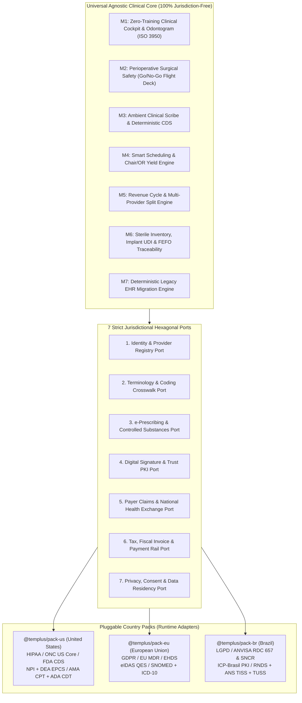
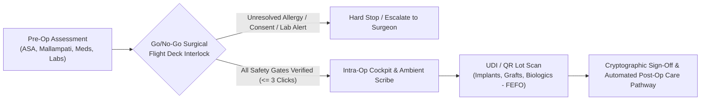

# Templus: Hexagonal Multi-Jurisdictional EHR/ERP & Clinical AI Architecture

[-6F42C1?style=flat)](#zero-training-clinical-ux--perioperative-surgical-safety)

**Clinical Product Lead & Health Informatics Architect:** [Guilherme Trentini, DDS](https://www.linkedin.com/in/drtrentini/) (Senior Dental & Facial Surgeon, 18+ Yrs)

---

## 1. Architectural Vision & Authoring Methodology

> While already developing our clinical platform under a country-specific lens, I saw that local rules inside the core blocked global interoperability. I decided to start from zero around a Universal Core with pluggable Country Packs. Using step-by-step AI orchestration and deterministic guardrails, I anchored the core on HL7 FHIR and SNOMED CT, locking a 49-table universal blueprint and a 65-system migration spec before writing code.

**Templus** (`templ.us`) is a multi-tenant, high-acuity Electronic Health Record (EHR), Perioperative Surgical Suite, and Healthcare ERP designed for outpatient surgical centers, oral & maxillofacial practices, facial aesthetic clinics, and multi-disciplinary medical-dental groups.

### Specification-Driven Agentic Engineering
This system is architected by a practicing Senior Dental & Facial Surgeon (`18+ years` of clinical and operating room experience) acting as **Clinical Product Lead and Health Informatics Practitioner**:
* **Domain & Clinical Architecture:** Every clinical workflow, perioperative safety interlock, semantic binding (`HL7 FHIR R4/R5`, `SNOMED CT`, `ISO 3950`), and regulatory constraint (`HIPAA`, `FDA Non-Device CDS`, `EU MDR`, `ANVISA SaMD`) is specified from real-world surgical and outpatient operations.
* **Agentic Execution with Deterministic Guardrails:** Software engineering artifacts, multi-tenant SQL schemas, and interoperability adapters are orchestrated through autonomous AI agents (`Google Antigravity & Gemini`) coupled to an executable [Deterministic Clinical Harness](https://github.com/Guitrentz/clinical-ai-deterministic-harness) that enforces mathematical checksums, static security gates (AST/SAST), and strict schema contracts before any commit.

> **Intellectual Property Notice:** This public repository publishes the system's **Hexagonal Architectural Blueprints, Semantic Interoperability Patterns, Architecture Decision Records (ADRs), and Release Changelogs**. Proprietary commercial source code and production multi-tenant SQL implementations reside in private repositories.

---

## 2. Universal Agnostic Core + Pluggable Country Packs

Healthcare software traditionally fails when scaling across borders because local billing codes, tax engines, and national digital signatures are hardcoded into the clinical core.

Templus solves this through a strict **Hexagonal Architecture (Ports & Adapters)**:
* **The Universal Agnostic Core (`en-US`):** Contains 100% jurisdiction-free clinical workflows, `HL7 FHIR R4/R5` canonical resources, `SNOMED CT` clinical concepts, `ISO 3950` anatomical odontogram/craniofacial models, sterile lot tracking (`FEFO`), and multi-tenant `PostgreSQL Row-Level Security (RLS)`.
* **Pluggable Country Packs (`@templus/pack-us`, `@templus/pack-eu`, `@templus/pack-br`):** Self-contained jurisdictional adapters injected at runtime via **7 Strict Jurisdictional Ports** and **5 UI Extension Slots**.

### The 7 Jurisdictional Ports Matrix

| Port ID | Architectural Port Contract | `@templus/pack-us` (United States) | `@templus/pack-eu` (European Union) | `@templus/pack-br` (Brazil) |
| :--- | :--- | :--- | :--- | :--- |
| **Port 1** | `Identity & Provider Registry` | `SSN` (masked), `US NPI` (Luhn 80840), State License, `DEA` | National eID, European Health Insurance Card (`EHIC`), Regional Medical/Dental Council | `CPF/CNPJ`, `CNS` (Cartao SUS), `CRM / CRO` Regional Verification |
| **Port 2** | `Terminology & Procedure Coding` | `SNOMED CT` US Edition, `ICD-10-CM`, `AMA CPT`, `ADA CDT` | `SNOMED CT` Member Release, `ICD-10-WHO`, National Procedure Catalogs | `SNOMED CT`, `CID-10`, `ANS TUSS`, `CBHPM` |
| **Port 3** | `e-Prescribing & Controlled Meds` | `NCPDP SCRIPT`, `DEA EPCS` two-factor controlled substances | Cross-Border eHDSI ePrescription | `ANVISA SNCR` (RDC 1.002/2026) National Controlled Registry |
| **Port 4** | `Cryptographic Clinical Signature` | Electronic signature compliant with `21 CFR Part 11` & State EHR rules | `eIDAS` Qualified Electronic Signature (`QES`) | `ICP-Brasil` (`A1/A3` Cloud PKI, Law 14.063/2020) |
| **Port 5** | `National Health Exchange & Claims` | `HL7 FHIR US Core`, `ASC X12N 837P / 837D` Clearinghouse | `HL7 FHIR EU Laboratory & Hospital Discharge` (EHDS) | `HL7 FHIR BR Core (RNDS)` & `ANS TISS v4+` XML/Hash |
| **Port 6** | `Payment Rails & Fiscal Compliance` | Stripe Health / ACH / HSA-FSA Card Split | SEPA Instant / PSD2 Open Banking / VAT Exemption Rules | Pix Instant Rail, Automated Provider Split & Municipal `NFS-e` |
| **Port 7** | `Privacy, Audit & Data Residency` | `HIPAA Safe Harbor` & Security Rule (`AWS us-east-1`) | `GDPR` Art. 9 Special Category Data (`AWS eu-central-1`) | `LGPD` Health Data Protection (`AWS sa-east-1`) |

### The 5 UI Extension Slots
To prevent fork divergence in the frontend, Country Packs inject localized micro-views strictly into 5 deterministic slots:
1. `slot:patient-registration-kyc`: Local national identifiers, insurance card OCR, and statutory privacy consent forms.
2. `slot:clinical-encounter-compliance`: Country-specific mandatory fields during clinical charting (such as occupational health or statutory notifications).
3. `slot:eprescription-signing-modal`: Hardware token, cloud certificate (`ICP-Brasil` / `eIDAS`), or `DEA EPCS` step-up authentication dialog.
4. `slot:claim-scrubbing-drawer`: Real-time validation of `X12 837D/837P` (US) or `ANS TISS` (BR) claim rules before submission.
5. `slot:checkout-fiscal-split`: Local tax rules, healthcare professional commission split, and automated invoice emission.

---

## 3. Zero-Training Clinical UX & Perioperative Surgical Safety

Clinician burnout in commercial EHRs stems from fragmented tab navigation, modal fatigue, and poorly structured clinical data entry. Templus enforces a clinical design doctrine derived directly from surgical practice:

### Single-Sheet Zero-Scroll Cockpit (`<= 3 Clicks Budget`)
* **Interaction Budget:** Every core outpatient or surgical task (reviewing patient history, charting an anatomical finding, ordering a prescription, or clearing a patient for surgery) must complete in **3 clicks or fewer**.
* **Single-Sheet Continuity:** Instead of burying vital signs, allergies, odontograms, facial maps, and medications across 12 separate tabs, the clinician operates inside a unified **Single-Sheet Zero-Scroll Cockpit** with contextual progressive disclosure.

### Perioperative Surgical Safety: Go/No-Go Flight Deck
Before any surgical procedure, sedation, or high-risk facial intervention begins, the interface transitions into a mandatory **Go/No-Go Flight Deck** inspired by aviation pre-flight verification:
* **Automated Clinical Interlocks:** Cross-checks active anticoagulants, bisphosphonates, systemic allergies (`SNOMED CT` substance hierarchy), `ASA Physical Status`, `Mallampati Score`, preoperative fasting window, and signed procedural consent.
* **Sterile Implant & Biomaterial Traceability (`UDI` / `QR` / `FEFO`):** Direct barcode/QR scanning of titanium implants, bone grafts, membranes, and injectable biologics (`Botulinum Toxin`, `Hyaluronic Acid` fillers), binding exact lot numbers, expiration dates (`First-Expired, First-Out`), and anatomical placement sites directly to the patient's permanent surgical record.

---

## 4. Clinical AI Governance & Deterministic Safety Harness

Templus integrates **Ambient Clinical Scribe** and **Clinical Decision Support (CDS)** under strict regulatory and mathematical controls:
1. **Pre-LLM De-Identification:** All unstructured clinical notes and transcripts pass through a deterministic `HIPAA Safe Harbor` scrubber before leaving the boundary for external LLM inference.
2. **Terminology Verification:** LLMs are never trusted to generate raw clinical codes unverified. Every candidate `SNOMED CT` concept (`SCTID`), `ICD-10` code, or provider/device identifier (`NPI`, `DEA`, `UDI`, `CNS`) is validated against deterministic algorithmic checksums (such as the **Verhoeff dihedral group $D_5$ check** for `SCTID`) via [`clinical-ai-deterministic-harness`](https://github.com/Guitrentz/clinical-ai-deterministic-harness).
3. **FDA Non-Device CDS Transparency:** Clinical suggestions always expose the underlying clinical rationale, peer-reviewed guideline source, and structured patient attributes so the clinician can independently review the basis of every recommendation.

---

## 5. Architecture Decision Records (ADRs)

| ADR | Title & Scope | Status |
| :--- | :--- | :--- |
| [**ADR-001**](./docs/adr/ADR-001-hexagonal-country-packs.md) | Hexagonal Multi-Jurisdictional Core and Pluggable Country Packs (`7 Ports + 5 UI Slots`) | `Accepted (v0.3.0)` |
| [**ADR-002**](./docs/adr/ADR-002-zero-training-clinical-ux.md) | Zero-Training Clinical UX (`<= 3 Clicks` Single-Sheet Cockpit) & Perioperative Surgical Go/No-Go Flight Deck | `Accepted (v0.3.0)` |
| [**ADR-003**](./docs/adr/ADR-003-deterministic-migration-engine.md) | Deterministic Legacy EHR Data Migration Engine (`5 Archetypes, Dry-Run & 1-Click Rollback`) | `Accepted (v0.3.0)` |

---

## 6. Release Roadmap & Current Status

See [`CHANGELOG.md`](./CHANGELOG.md) for detailed engineering milestones.

* **[x] Phase I (Completed):** Universal Agnostic Core Blueprint (`49 Multi-Tenant PostgreSQL RLS Tables`, `7 Jurisdictional Ports`, `5 UI Extension Slots`) and `@templus/pack-br` Jurisdictional Specification.
* **[x] Phase IA (Completed):** Deep Benchmarking of 65 Commercial Healthcare SaaS Platforms & Deterministic Legacy EHR Migration Engine Specification (`Dry-Run` + `DICOM` + `1-Click Rollback`).
* **[ ] Phase II (In Progress):** Modular Deep-Dive Specifications (`M1` through `M7`) separating Universal Core contracts from Country Pack adapters.
