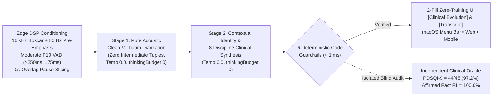
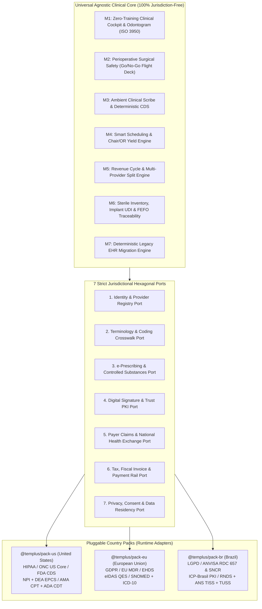
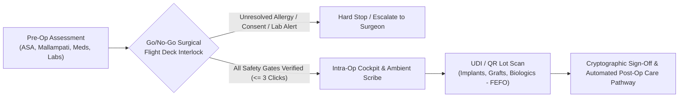

# Templus: EHR-Agnostic Ambient Clinical Scribe (`v6.2`) & Hexagonal Multi-Jurisdictional EHR/ERP Architecture

[-2EA44F?style=flat)](./docs/adr/ADR-007-decoupled-ambient-scribe-multi-agent-engineering-and-pdsqi9-oracle.md)
[-0066CC?style=flat)](./CHANGELOG.md)

[-6F42C1?style=flat)](#4-foundational-enterprise-blueprint-zero-training-clinical-ux--perioperative-safety)

**Clinical Product & Workflow Advisor:** [Guilherme Trentini, DDS](https://www.linkedin.com/in/drtrentini/) (Senior Dental & Facial Surgeon, 18+ Yrs | *SNOMED CT Foundation Certified*, 2026)

---

## 1. Architectural Vision, Scope Split & Multi-Agent Engineering Methodology

**Templus** (`templ.us`) is an independent clinical product discovery and applied Health Informatics R&D initiative organized into two strictly segregated architectural tracks:

1. **Active Production R&D Track — Standalone EHR-Agnostic Ambient Clinical Scribe (`v6.2 / Beta 0.8.0`):** A cross-device ambient voice-to-note utility (`macOS Menu Bar` Universal Binary + `2-Column Web Workspace` + `Mobile Pocket Recorder`) 100% decoupled from any EHR database (`Zero Lock-In`). It combines client-side **Edge DSP audio conditioning**, a **Two-Stage Heterogeneous Multi-LLM Pipeline (`Zero Tuples`, `thinkingBudget: 0`)** supporting **8 regulated healthcare professions**, **6 sub-millisecond deterministic clinical safety guardrails**, and an **Independent Blind Clinical Oracle** scoring `PDSQI-9 = 44/45 (97.2%)` and `100.0%` F1 recall/precision on affirmed clinical facts ([ADR-007](./docs/adr/ADR-007-decoupled-ambient-scribe-multi-agent-engineering-and-pdsqi9-oracle.md)).
2. **Foundational Enterprise Blueprint — Hexagonal Multi-Jurisdictional EHR/ERP Core (`Frozen Reference at v0.3.3`):** A complete 49-table multi-tenant `PostgreSQL Row-Level Security (RLS)` architecture separating a 100% jurisdiction-free clinical core (`HL7 FHIR R4/R5`, `SNOMED CT`, `ISO 3950`, `<= 3 clicks` surgical cockpit) from pluggable Country Packs (`@templus/pack-us`, `@templus/pack-eu`, `@templus/pack-br`) via 7 Hexagonal Ports, 5 UI Extension Slots, and a 65-system Legacy EHR Migration specification ([ADR-001](./docs/adr/ADR-001-hexagonal-country-packs.md) to [ADR-005](./docs/adr/ADR-005-zero-phi-crm-gist-scheduling-and-postop-recall-m2.md)).

### Surgeon-Led Multi-Agent, Multi-LLM Orchestration (`OpenCode`)
> **Transparency Note on Authorship:** I am a practicing Senior Dental & Facial Surgeon (`18+ years` of clinical and surgical experience) with foundational training in Health Informatics (*SNOMED CT Foundation Certified*, Oct 2026; conceptual *HL7 FHIR R4/R5* architecture). I am **not** a career software developer, DBA, or traditional FHIR systems engineer.
>
> Every specification, deterministic guardrail, and production component in this project was built by operating as the **Clinical Architect, Product Specifier, and Final Clinical Safety Auditor**, orchestrating a specialized team of heterogeneous LLM subagents inside **OpenCode** under Andrej Karpathy's surgical execution principles:
* **`@explore` (Context Hygiene Gate):** Indexes relevant specifications and code modules before planning, avoiding context dilution.
* **`@architect` (Structural & Schema Gate):** Audits state machines, `PostgreSQL RLS` policies, and API contracts before code is written.
* **`@general` & `@surgeon` (Deterministic Execution Gate):** Applies minimal-blast-radius edits and runs strict `typecheck`, `test`, and `build` verification loops.
* **`@security-review` & Independent Clinical Oracle (Safety Gate):** Verifies multi-tenant isolation, `AES-256-GCM + AAD` encryption, and blind `PDSQI-9` clinical note quality before release.

> **Intellectual Property Notice:** This public repository publishes the system's **Architectural Blueprints, Clinical Safety Guardrail Patterns, Scientific Benchmark Methodology, Architecture Decision Records (ADRs), and Changelogs**. Proprietary commercial source code, prompt pairings, and production SQL/Swift implementations reside in private repositories, while the executable verification layer is open-sourced in [`clinical-ai-deterministic-harness`](https://github.com/Guitrentz/clinical-ai-deterministic-harness).

---

## 2. Active Track: Standalone EHR-Agnostic Ambient Clinical Scribe (`v6.2 Beta`)

First-generation ambient scribes fail in outpatient surgery and multi-disciplinary care because they rely on single-pass prompts that silently omit ~18% of clinical facts (`Taylor et al., 2026`), invert negations, swap `RIGHT`/`LEFT` anatomical laterality, leak financial budget discussions into the legal medical record, or attribute a companion's speech to the patient.

**Templus Scribe (`v6.2`)** eliminates these failure modes through a decoupled 4-layer architecture ([ADR-007](./docs/adr/ADR-007-decoupled-ambient-scribe-multi-agent-engineering-and-pdsqi9-oracle.md)):

### Key Differentiators of the `v6.2` Scribe Engine
1. **Edge DSP Audio Conditioning (`Zero Local STT`):** Applies *Boxcar* anti-aliased decimation to `16 kHz Mono PCM16` and an `80 Hz` high-pass filter to preserve consonant fricatives under dental handpiece and surgical suction noise (`2–6 kHz`). A **Moderate Dynamic `P10` VAD (`> 250ms, ±75ms`)** slices audio at natural speech pauses with `0s overlap` while protecting short monosyllabic negation particles (*"no"*, *"not"*, *"não"*, *"sem"*).
2. **Elimination of the Intermediate Tuple Bottleneck (`Zero Tuples` in Stage 1):** Stage 1 performs pure acoustic clean-verbatim multi-speaker transcription (`temperature: 0.0`, `thinkingBudget: 0`). Stage 2 maps speaker identities (`CLINICIAN`, `ASSISTANT`, `PATIENT`, `COMPANION`) and synthesizes the clinical evolution across **8 regulated healthcare professions** (`Medicine`, `Dentistry/OMFS`, `Nursing`, `Physical Therapy`, `Occupational Therapy`, `Nutrition ADIME`, `Psychology`, and `Speech-Language Pathology`) with `thinkingBudget: 0` so the model never extrapolates unperformed normal physical exams.
3. **Six Sub-Millisecond Deterministic Code Guardrails (`< 1 ms`):**
   * *Role-Authority & Temporal Firewall:* Blocks patient/companion speech and past/family history from Objective Exam or Procedure Performed sections.
   * *Sentence-Level Negation & Uncertainty Verifier:* Prevents silent polarity inversion and stops diagnostic hypotheses (*"rule out"*) from turning into confirmed diagnoses.
   * *Numeric Dosage & Tooth-Site Conservation:* Verifies that 100% of medication dosages (`mg`, `mcg`, `mL`, `UI`, `%`) and tooth numbers in the note exist in the source transcript.
   * *Anatomical Laterality Cross-Talk Verifier:* Prevents `RIGHT`/`LEFT` inversion across multiple surgical sites.
   * *Medico-Legal Commercial Pricing Scrubber:* Strips currency values, treatment quotes, and payment terms from the `[Clinical Evolution]` while preserving them verbatim in the `[Transcript]`.
   * *Safe Patient Identity Anchor (`Zero Wrong-Patient`):* Binds patient identity strictly to the `PATIENT` speaker role, rejecting the clinician's name, referred colleagues (`Dr.`/`Dra.`), and companions.
4. **Independent Blind Clinical Oracle (`PDSQI-9 = 44/45`, `Fact F1 = 100.0%`):** An isolated auditing service evaluates generated notes blindly against ground-truth audio and transcripts using the peer-reviewed **`PDSQI-9` rubric (`44/45 = 97.2%`)**, memory-bounded **$O(M)$ rolling-row `mWER`**, and **`CREOLA` omission taxonomy (`100.0%` F1 on affirmed clinical facts, `0` hallucinations, `0` polarity inversions, `0` dosage errors)** on a 55-minute real outpatient consultation.
5. **Cross-Device Ergonomics & `72h` Crypto-Shredding:** Delivers a 2-pill zero-training UI (`[Clinical Evolution]` and `[Transcript]`) across a `335px` **macOS Menu Bar HUD**, **Web Workspace**, and **Mobile Pocket Recorder** (`Screen Wake Lock API`), enforcing `1 Active Desktop + 1 Mobile` dual-slot coexistence, `AES-256-GCM + AAD` encryption at rest, `72-hour` ephemeral retention, and 1-click cascading *Crypto-Shredding*.

---

## 3. Foundational Enterprise Blueprint: Universal Agnostic Core + Pluggable Country Packs (`Frozen Reference at v0.3.3`)

Healthcare software traditionally fails when scaling across borders because local billing codes, tax engines, and national digital signatures are hardcoded into the clinical core.

Templus solves this through a strict **Hexagonal Architecture (Ports & Adapters)**:
* **The Universal Agnostic Core (`en-US`):** Contains 100% jurisdiction-free clinical workflows, `HL7 FHIR R4/R5` canonical resources, `SNOMED CT` clinical concepts, `ISO 3950` anatomical odontogram/craniofacial models, sterile lot tracking (`FEFO`), and multi-tenant `PostgreSQL Row-Level Security (RLS)`.
* **Pluggable Country Packs (`@templus/pack-us`, `@templus/pack-eu`, `@templus/pack-br`):** Self-contained jurisdictional adapters injected at runtime via **7 Strict Jurisdictional Ports** and **5 UI Extension Slots**.

### The 7 Jurisdictional Ports Matrix

| Port ID | Architectural Port Contract | `@templus/pack-us` (United States) | `@templus/pack-eu` (European Union) | `@templus/pack-br` (Brazil) |
| :--- | :--- | :--- | :--- | :--- |
| **Port 1** | `Identity & Provider Registry` | `SSN` (masked), `US NPI` (Luhn 80840), State License, `DEA` | National eID, European Health Insurance Card (`EHIC`), Regional Medical/Dental Council | `CPF/CNPJ`, `CNS` (Cartao SUS), `CRM / CRO` Regional Verification |
| **Port 2** | `Terminology & Procedure Coding` | `SNOMED CT` US Edition, `ICD-10-CM`, `AMA CPT`, `ADA CDT` | `SNOMED CT` Member Release, `ICD-10-WHO`, National Procedure Catalogs | `SNOMED CT`, `CID-10`, `ANS TUSS`, `CBHPM` |
| **Port 3** | `e-Prescribing & Controlled Meds` | `NCPDP SCRIPT`, `DEA EPCS` two-factor controlled substances | Cross-Border eHDSI ePrescription | `ANVISA SNCR` (RDC 1.002/2026) National Controlled Registry |
| **Port 4** | `Cryptographic Clinical Signature` | Electronic signature compliant with `21 CFR Part 11` & State EHR rules | `eIDAS` Qualified Electronic Signature (`QES`) | `ICP-Brasil` (`A1/A3` Cloud PKI, Law 14.063/2020) |
| **Port 5** | `National Health Exchange & Claims` | `HL7 FHIR US Core`, `ASC X12N 837P / 837D` Clearinghouse | `HL7 FHIR EU Laboratory & Hospital Discharge` (EHDS) | `HL7 FHIR BR Core (RNDS)` & `ANS TISS v4+` XML/Hash |
| **Port 6** | `Payment Rails & Fiscal Compliance` | Stripe Health / ACH / HSA-FSA Card Split | SEPA Instant / PSD2 Open Banking / VAT Exemption Rules | Pix Instant Rail, Automated Provider Split & Municipal `NFS-e` |
| **Port 7** | `Privacy, Audit & Data Residency` | `HIPAA Safe Harbor` & Security Rule (`AWS us-east-1`) | `GDPR` Art. 9 Special Category Data (`AWS eu-central-1`) | `LGPD` Health Data Protection (`AWS sa-east-1`) |

### The 5 UI Extension Slots
To prevent fork divergence in the frontend, Country Packs inject localized micro-views strictly into 5 deterministic slots:
1. `slot:patient-registration-kyc`: Local national identifiers, insurance card OCR, and statutory privacy consent forms.
2. `slot:clinical-encounter-compliance`: Country-specific mandatory fields during clinical charting (such as occupational health or statutory notifications).
3. `slot:eprescription-signing-modal`: Hardware token, cloud certificate (`ICP-Brasil` / `eIDAS`), or `DEA EPCS` step-up authentication dialog.
4. `slot:claim-scrubbing-drawer`: Real-time validation of `X12 837D/837P` (US) or `ANS TISS` (BR) claim rules before submission.
5. `slot:checkout-fiscal-split`: Local tax rules, healthcare professional commission split, and automated invoice emission.

---

## 4. Foundational Enterprise Blueprint: Zero-Training Clinical UX & Perioperative Safety

Clinician burnout in commercial EHRs stems from fragmented tab navigation, modal fatigue, and poorly structured clinical data entry. Templus enforces a clinical design doctrine derived directly from surgical practice:

### Single-Sheet Zero-Scroll Cockpit (`<= 3 Clicks Budget`)
* **Interaction Budget:** Every core outpatient or surgical task (reviewing patient history, charting an anatomical finding, ordering a prescription, or clearing a patient for surgery) must complete in **3 clicks or fewer**.
* **Single-Sheet Continuity:** Instead of burying vital signs, allergies, odontograms, facial maps, and medications across 12 separate tabs, the clinician operates inside a unified **Single-Sheet Zero-Scroll Cockpit** with contextual progressive disclosure.

### Perioperative Surgical Safety: Go/No-Go Flight Deck
Before any surgical procedure, sedation, or high-risk facial intervention begins, the interface transitions into a mandatory **Go/No-Go Flight Deck** inspired by aviation pre-flight verification:
* **Automated Clinical Interlocks:** Cross-checks active anticoagulants, bisphosphonates, systemic allergies (`SNOMED CT` substance hierarchy), `ASA Physical Status`, `Mallampati Score`, preoperative fasting window, and signed procedural consent.
* **Sterile Implant & Biomaterial Traceability (`UDI` / `QR` / `FEFO`):** Direct barcode/QR scanning of titanium implants, bone grafts, membranes, and injectable biologics (`Botulinum Toxin`, `Hyaluronic Acid` fillers), binding exact lot numbers, expiration dates (`First-Expired, First-Out`), and anatomical placement sites directly to the patient's permanent surgical record.

---

## 5. Architecture Decision Records (ADRs)

| ADR | Title & Scope | Status |
| :--- | :--- | :--- |
| [**ADR-001**](./docs/adr/ADR-001-hexagonal-country-packs.md) | Hexagonal Multi-Jurisdictional Core and Pluggable Country Packs (`7 Ports + 5 UI Slots`) | `Accepted (Frozen Core v0.3.0)` |
| [**ADR-002**](./docs/adr/ADR-002-zero-training-clinical-ux.md) | Zero-Training Clinical UX (`<= 3 Clicks` Single-Sheet Cockpit) & Perioperative Surgical Go/No-Go Flight Deck | `Accepted (Frozen Core v0.3.0)` |
| [**ADR-003**](./docs/adr/ADR-003-deterministic-migration-engine.md) | Deterministic Legacy EHR Data Migration Engine (`5 Archetypes, Dry-Run & 1-Click Rollback`) | `Accepted (Frozen Core v0.3.0)` |
| [**ADR-004**](./docs/adr/ADR-004-fractal-atomic-specification-m1-foundation.md) | Fractal Atomic Decomposition for Module 1 Foundation (`13 Atomic Units / 26 Paired Core + Country Pack Specs`) | `Accepted (Frozen Core v0.3.1)` |
| [**ADR-005**](./docs/adr/ADR-005-zero-phi-crm-gist-scheduling-and-postop-recall-m2.md) | Multi-Resource GiST Scheduling, Zero-PHI CRM Segregation & Post-Op Recall (`Module 2: 8 Atomic Units / 16 Paired Specs`) | `Accepted (Frozen Core v0.3.2)` |
| [**ADR-006**](./docs/adr/ADR-006-air-gapped-ambient-scribe-snomed-mrcm-guardrails.md) | Air-Gapped Two-Stage Ambient Clinical Scribe with `SNOMED CT MRCM` Role Groups & Deterministic Safety Firewalls | `Superseded in Standalone Track by ADR-007` |
| [**ADR-007**](./docs/adr/ADR-007-decoupled-ambient-scribe-multi-agent-engineering-and-pdsqi9-oracle.md) | EHR-Agnostic Standalone Ambient Scribe (`v6.2`), 6 Deterministic Clinical Guardrails, Multi-Agent Engineering Gates & Independent `PDSQI-9` Oracle | `Accepted & Active Production Track (v6.2 / Beta 0.8.0)` |

---

## 6. Release Roadmap & Current Status

See [`CHANGELOG.md`](./CHANGELOG.md) for detailed engineering milestones.

* **[x] Standalone EHR-Agnostic Ambient Clinical Scribe (`v6.2 / Beta 0.8.0` — 100% Active Focus):** Native `macOS Menu Bar Universal Binary` (`335px` HUD, `macOS Keychain`), `2-Column Web Workspace`, `Mobile Pocket Recorder` (`Screen Wake Lock`, dual-slot `1 Desktop + 1 Mobile`), Edge DSP (`16 kHz Boxcar`, `80 Hz` pre-emphasis, `P10 VAD`), Pure 2-Stage Multi-LLM Engine (`Zero Tuples`, `thinkingBudget: 0`, 8 regulated healthcare professions), 6 Deterministic Sub-Millisecond Code Guardrails, `AES-256-GCM + AAD` `72h` Ephemeral Retention with *Crypto-Shredding*, and Independent Blind Clinical Oracle (`PDSQI-9 = 44/45 [97.2%]`, `Fact F1 = 100.0%`).
* **[x] Foundational Enterprise EHR/ERP Blueprint — Phase I & IA (Completed & Frozen Reference):** Universal Agnostic Core Blueprint (`49 Multi-Tenant PostgreSQL RLS Tables`, `7 Jurisdictional Ports`, `5 UI Extension Slots`), `@templus/pack-br` Jurisdictional Specification, 65-Platform Competitive Benchmark, and Deterministic Legacy EHR Migration Engine Specification (`Dry-Run` + `DICOM` + `1-Click Rollback`).
* **[x] Foundational Enterprise EHR/ERP Blueprint — Phase II, Modules 1 & 2 (Completed & Frozen Reference):** `21 Atomic Units / 42 Paired Specifications` covering Platform Foundation, `PostgreSQL FORCE RLS`, `WORM` Hash-Chain, `HL7 FHIR R5 MonetaryComponent`, `SNOMED CT` Verhoeff, 7-Pillar Shell, Multi-Resource `GiST` Scheduling, Zero-PHI Commercial CRM Segregation, and Post-Operative Surgical Recall (`D+1/D+3/D+7`).
