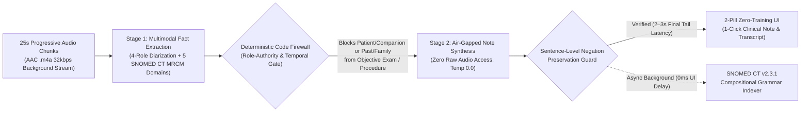

# ADR-006: Air-Gapped Two-Stage Ambient Clinical Scribe with `SNOMED CT MRCM` Role Groups and Deterministic Safety Firewalls

* **Status:** Accepted & Implemented in Production (`v0.3.3-alpha`)
* **Date:** 2026-11-08
* **Author:** Guilherme Trentini, DDS (Clinical Product Lead & Health Informatics Practitioner, directing AI agents via Clinical Macro/Micromanagement)

---

## Context

First-generation Ambient AI Scribes rely on a single end-to-end LLM prompt that ingests a consultation recording and outputs a clinical note directly. In surgical and multi-disciplinary outpatient practice, single-pass audio-to-note generation introduces four unacceptable clinical safety and ergonomic failures:

1. **Anatomical & Laterality Cross-Talk:** When a surgeon discusses or performs interventions across multiple anatomical sites in the same session (for example, an extraction on the *right* mandible and a mucosal lesion biopsy on the *left* maxilla), flat LLM prompts frequently swap laterality (`RIGHT` vs. `LEFT`) or bind the wrong dosage to the wrong site.
2. **Role-Authority & Temporal Contamination:** A patient or companion statement about a past or family event (*"my father had a stroke"* or *"I had a root canal two years ago"*) is frequently hallucinated by single-stage LLMs into today's clinician-verified Objective Physical Exam or Procedure Performed section.
3. **Silent Polarity Inversion:** An LLM may preserve negation in the first clause (*"Patient denies fever"*) while silently dropping the negation particle in a subsequent sentence (*"Presents with trismus"* instead of *"No trismus"*).
4. **Post-Encounter Latency & Ontology Clutter:** Uploading a single 60-minute WAV file at the end of a consultation creates a 30 to 60 second wait, while forcing clinicians to manually select their specialty from a dropdown or pick `SNOMED CT` codes from a list slows down clinical care.

---

## Decision

We architected and deployed a **Two-Stage Air-Gapped Ambient Clinical Scribe Engine** governed by **5 deterministic clinical informatics invariants**:

### 1. Progressive `25s` Audio Micro-Chunking (`~2 to 3s` Final Delivery)
* Clients capture audio in lightweight `AAC .m4a` (`16 kHz mono`, `32 kbps`, 93% smaller than uncompressed WAV) and stream progressive `25-second` micro-chunks in the background during the encounter.
* Even in a 60-minute consultation or surgical procedure, prior segments are already extracted while the encounter is underway. Clicking **Stop** processes only the final tail, delivering the completed clinical note in **2 to 3 seconds** with identical behavior across desktop (`macOS Menu Bar` / `Windows Tray`), web kiosk, and mobile devices.

### 2. Zero-Selector Multi-Disciplinary Detection via 5 `SNOMED CT MRCM` Domains
* We eliminated manual specialty dropdowns and visible coding lists. Stage 1 automatically classifies clinical facts across all healthcare disciplines (Medicine, Surgery, Oral & Maxillofacial / Dentistry, Nursing, Physical Therapy, Speech Therapy, Psychology, Nutrition, and Occupational Therapy) using the **5 care domains of the `SNOMED CT Machine Readable Concept Model (MRCM)`**:
  * `CLINICAL_FINDING` (`<<404684003 |Clinical finding|`)
  * `PROCEDURE_INTERVENTION` (`<<71388002 |Procedure|`)
  * `OBSERVABLE_PARAMETER` (`<<363787002 |Observable entity|`)
  * `MEDICATION_SUBSTANCE` (`<<373873005 |Pharmaceutical / biologic product|`)
  * `SITUATION_EXPLICIT_CONTEXT` (`<<243796009 |Situation with explicit context|`)

### 3. Closed `SNOMED CT MRCM` Role Groups (`Zero Cross-Talk`)
* Every clinical fact extracted in Stage 1 is encapsulated inside an immutable **Role Group Atom** (`{ mrcmDomain, targetSiteOrStructure, laterality, methodOrMorphology, substanceOrDose, temporalContext, experiencer, polarity }`).
* Binding `targetSiteOrStructure` and `laterality` inside the same atomic tuple prevents cross-talk between `RIGHT` and `LEFT` findings or between distinct teeth and anatomical structures.

### 4. Physical Two-Stage Air-Gap + Deterministic Role-Authority Firewall
* **Stage 1 (`Multimodal Extraction`):** Processes the clinician's 8-second voice calibration reference and the encounter audio to output a 4-role diarized transcript (`CLINICIAN`, `ASSISTANT`, `PATIENT`, `COMPANION_GUARDIAN`) and the array of `MRCM` Role Group Atoms.
* **Deterministic Code Firewall:** Before Stage 2 executes, a deterministic function (`enforce_mrcm_authority_and_temporal_firewall`) blocks any atom spoken by `PATIENT` or `COMPANION_GUARDIAN`, as well as any `PAST_HISTORY` or `FAMILY_MEMBER` atom (`<<243796009`), from entering the Objective Physical Exam or Procedure Performed partition.
* **Stage 2 (`Air-Gapped Synthesis from Verified Atoms Only`):** A second physical model call (`temperature: 0.0`, `thinkingBudget: 0`) **never sees the raw audio or raw transcript**. It synthesizes the clinical note strictly from the firewall-verified `MRCM` atoms, automatically omitting the Physical Exam section if no objective examination was performed during the session.

### 5. Sentence-Level Negation Guard & Invisible `SNOMED CT v2.3.1` Background Indexing
* **Sentence-Level Polarity Guard:** Before releasing the note, `verify_sentence_level_negation` inspects each sentence individually to confirm that every `NEGATED` clinical atom retained an explicit negation particle in its target sentence.
* **Invisible Ontology & 2-Pill Clinical UX:** Clinicians never see ontological codes on screen. The UI presents strictly **2 unified action pills** (`[Clinical Note / Evolution]` integrating any procedure performed, and `[Transcript]`) for instant 1-click copy (`Left-Click`) or full-text inspection (`Right-Click`), while post-coordinated **`SNOMED CT Compositional Grammar v2.3.1`** expressions are compiled asynchronously in the background (`0 ms` UI latency).

---

## Consequences

### Positive
* **Elimination of Cross-Talk & Authority Hallucinations:** Patient-reported history can never masquerade as a clinician-performed physical exam or surgical intervention.
* **Sub-3-Second Turnaround on 60-Minute Encounters:** Progressive `25s` micro-chunking removes end-of-visit waiting time.
* **Zero Cognitive Overhead for Clinicians:** Delivers full `SNOMED CT MRCM` and Compositional Grammar structural rigor underneath a 2-button, zero-training interface.

### Reference Implementation
* Open-source Python reference implementations of the **MRCM Authority/Temporal Firewall**, **Sentence-Level Negation Verifier**, and **Verified SNOMED CT Compositional Grammar Builder** are published with automated unit tests in [`clinical-ai-deterministic-harness`](https://github.com/Guitrentz/clinical-ai-deterministic-harness).
