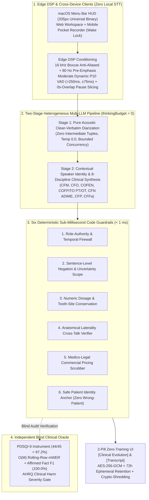

# ADR-007: EHR-Agnostic Standalone Ambient Scribe (`v6.2`), Six Deterministic Clinical Guardrails, Multi-Agent Engineering Gates, and Independent `PDSQI-9` Oracle Evaluation

* **Status:** Accepted & Active R&D Production Track (`v6.2 / Beta 0.8.0`)
* **Date:** 2026-11-11
* **Author:** Guilherme Trentini, DDS (Senior Dental & Facial Surgeon, 18+ Yrs | Clinical Product & Workflow Advisor, orchestrating Multi-Agent, Multi-LLM Engineering Teams in OpenCode)

---

## Context

Following the initial `v0.3.3-alpha` prototype ([ADR-006](./ADR-006-air-gapped-ambient-scribe-snomed-mrcm-guardrails.md)), controlled stress-testing on real full-length (`45 to 60 minute`) clinical and surgical consultations exposed five architectural and clinical safety bottlenecks common to commercial ambient scribes:

1. **EHR Lock-In Blocks Immediate Clinical Utility:** Tying an ambient scribe directly to a monolithic EHR database prevents clinicians using legacy practice management systems from adopting safe voice-to-note workflows.
2. **Tuple Bottleneck & Boundary Duplication in Fixed Micro-Chunking:** Cutting audio at rigid `25s` intervals with `2s` overlap caused boundary word duplication, while forcing Stage 1 to compress rich dialogue into intermediate JSON fact tuples discarded clinical nuance before Stage 2 synthesis (`Lossy Tuple Bottleneck`).
3. **Reasoning-Token Extrapolation Hazard (`Thinking Budget > 0`):** Enabling hidden Chain-of-Thought (*thinking tokens*) during clinical note synthesis degraded factual fidelity (`Faisal, 2026`), causing models to extrapolate standard unperformed normal physical examination templates from brief anamnesis remarks.
4. **Silent Clinical Safety Failures in Commercial Scribes:** Peer-reviewed audits of ambient scribes (`Taylor et al., JAMA Netw Open /PMC 2026`; `CREOLA, NPJ Digit Med 2025`) show that ~18% of errors are silent omissions, alongside four recurring clinical hazards: numeric dosage alterations, anatomical laterality cross-talk (`Right` vs. `Left`), financial/treatment budget discussions leaking into the legal medical record, and *wrong-patient charting* when companions or referring doctors speak.
5. **Self-Grading Bias:** An AI scribe pipeline cannot objectively evaluate its own clinical safety without an isolated, independent auditing oracle anchored in validated medical documentation instruments.

---

## Decision

We separated the **Standalone EHR-Agnostic Ambient Clinical Scribe (`Templus Scribe v6.2 / Beta 0.8.0`)** as our 100% active production R&D track (while preserving the 49-table Enterprise EHR/ERP specifications from `ADR-001` through `ADR-005` as a frozen foundational blueprint) and implemented five architectural pillars:

### 1. Complete EHR Decoupling, Dual-Slot Session Integrity & `72h` Crypto-Shredding
* **Zero EHR Tables, Zero Visible Codes:** The standalone scribe contains zero permanent patient chart tables and exposes zero ontological codes on screen. It delivers strictly **2 unified action pills** (`[Clinical Evolution]` and `[Transcript]`) across a native **macOS Menu Bar Universal Binary** (`335px` fixed width, `macOS Keychain` credentials), a **2-Column Web Workspace**, and a **Mobile Pocket Recorder** (`< 768px` adaptive layout with `Screen Wake Lock API` and real-time `AnalyserNode` vocal reactivity).
* **Dual-Slot Hardware Coexistence:** Enforces single-active-desktop seat locking (`401` session-replacement lock on concurrent desktop logins) while permitting simultaneous `1 Active Desktop + 1 Mobile Pocket Recorder` coexistence for chairside recording and desktop paste.
* **Ephemeral Privacy by Design:** All persisted clinical text is encrypted at rest using `AES-256-GCM` with Additional Authenticated Data (`AAD`) and purged automatically after a strict **72-hour ephemeral TTL**, complemented by immediate cascading **1-Click Crypto-Shredding**.

### 2. Edge DSP Conditioning & Two-Stage Heterogeneous Multi-LLM Pipeline (`Zero Tuples`)
* **Edge DSP Pre-Processing (Zero Local STT):** To preserve vocal formants under dental high-speed handpiece and surgical suction noise (`2–6 kHz`), client audio undergoes *Boxcar* anti-aliased decimation to `16 kHz Mono PCM16`, an `80 Hz` high-pass pre-emphasis filter, and a **Moderate Dynamic `P10` Voice Activity Detector** (`silence > 250 ms` with `±75 ms` safety padding). Unlike aggressive VADs that clip short unstressed negation particles (*"no"*, *"not"*, *"não"*, *"sem"*), the `±75 ms` envelope preserves monosyllabic clinical negations intact and slices audio at natural speech pauses with **zero overlap (`0s`)**.
* **Stage 1 (Pure Acoustic Clean-Verbatim Diarization):** A fast multimodal acoustic model (`temperature: 0.0`, `thinkingBudget: 0`) transcribes each pause-guided segment into a clean-verbatim diarized dialogue without intermediate JSON tuple compression.
* **Stage 2 (Contextual Identity & 8-Discipline Clinical Synthesis):** A specialized clinical synthesis model (`temperature: 0.0`, `thinkingBudget: 0`, ephemeral prompt caching) resolves speaker roles (`CLINICIAN`, `ASSISTANT`, `PATIENT`, `COMPANION`) and structures the evolution according to the regulatory documentation standards of **8 healthcare professions**:
  1. **Medicine** (`SOAP` + Diagnostic Reasoning)
  2. **Dentistry & Oral and Maxillofacial Surgery** (`Intra/Extra-Oral Exam`, `FDI / Universal` tooth notation, Surgical Intervention & Material Lot Readiness)
  3. **Nursing** (`5-Stage Nursing Process`)
  4. **Physical Therapy** (`Functional & Kinetic-Functional Diagnosis`)
  5. **Occupational Therapy** (`Occupational Performance & Environmental Adaptation`)
  6. **Nutrition** (`ADIME` — Assessment, Diagnosis, Intervention, Monitoring/Evaluation)
  7. **Psychology** (`Descriptive Evolutive Narrative & Mental Status`)
  8. **Speech-Language Pathology** (`Communication, Voice, Orofacial Motricity & Dysphagia`)

### 3. Six Deterministic Sub-Millisecond Code Guardrails (`< 1 ms`)
Before any synthesized clinical note is accepted, six deterministic code gates execute in under `1 millisecond`:
1. **Role-Authority & Temporal Firewall:** Blocks patient/companion utterances and historical/family events from contaminating clinician-verified Objective Exam or Procedure Performed sections.
2. **Sentence-Level Negation & Uncertainty Scope Verifier:** Confirms sentence by sentence that every negated finding retains an explicit negation marker and that diagnostic hypotheses (*"rule out"*, *"suspected"*) are never promoted to confirmed diagnoses.
3. **Numeric Dosage & Tooth-Site Conservation Guard:** Extracts all medication concentrations, volumes, biological units (`mg`, `mcg`, `g`, `mL`, `UI/U`, `%`), and tooth identifiers from the synthesized note and verifies 100% grounding in the source transcript.
4. **Anatomical Laterality Cross-Talk Verifier:** Prevents bilateral/contralateral inversion (`RIGHT` vs. `LEFT`) across distinct anatomical structures mentioned in the same session.
5. **Medico-Legal Commercial Pricing Scrubber:** Strips currency values, fee quotes, and installment terms from the `[Clinical Evolution]` while preserving them verbatim in the `[Transcript]`, keeping the medical record free of billing clutter without corrupting clinical dosages.
6. **Safe Patient Identity Anchor (`Zero Wrong-Patient Charting`):** Extracts patient identity strictly anchored to the `PATIENT` speaker role, deterministically rejecting the authenticated clinician's own name, referred colleagues (`Dr.`/`Dra.`), and companion self-introductions (*"I am her mother"*).

### 4. Independent Blind Clinical Oracle Evaluation (`PDSQI-9 = 44/45`, `Fact F1 = 100.0%`)
* To eliminate self-grading bias, we built an isolated **Independent Clinical Oracle** service that audits raw audio, diarized transcripts, and synthesized clinical notes blindly across five peer-reviewed dimensions:
  * **Validated `PDSQI-9` Rubric (`Smith et al., JAMIA 2025 / NPJ Digit Med 2026`):** 9-item Provider Documentation Summarization Quality Instrument (`1–5` Likert scale, max `45`).
  * **Affirmed Clinical Fact Precision, Recall & `F1` (`CREOLA` Omission Taxonomy):** Penalizes silent clinical omissions as rigorously as fabrications.
  * **Memory-Bounded $O(M)$ Rolling-Row Medical Word Error Rate (`mWER`):** Evaluates full 60-minute consultations in $< 50\text{ KB}$ of RAM with `3x` weight on high-risk clinical tokens (drugs, dosages, negation particles, laterality).
  * **Zero-Tolerance Safety Gates (`AHRQ` Harm Scale):** Enforces `0` hallucinated assertions, `0` inverted negations, and `0` dosage mismatches.

| Scientific Audit Metric (55-Minute Real Outpatient Consultation Benchmark) | Target Gate | Audited Result (`v6.2`) |
| :--- | :--- | :--- |
| **Overall Clinical Oracle Score (`0–100`)** | `>= 92` | **`96 / 100` (`APPROVED_CLEAN`)** |
| **`PDSQI-9` Validated Clinical Quality Score (`Max 45`)** | `>= 40 / 45` | **`44 / 45` (`97.2%`)** |
| **Affirmed Clinical Fact Recall / Precision / `F1`** | `100.0%` | **`100.0%` (`14/14` Core Clinical Facts)** |
| **Hallucinated Assertions / Inverted Negations / Dosage Errors** | `0` | **`0 / 0 / 0`** |
| **Commercial Pricing Leakage in `[Clinical Evolution]`** | `0` | **`0` (Retained strictly in `[Transcript]`)** |

### 5. Surgeon-Led Multi-Agent, Multi-LLM Engineering Governance (`OpenCode`)
All engineering across the Scribe engine and deterministic harness follows a closed-loop multi-agent workflow directed by the surgeon in **OpenCode**:
1. **`@explore` (Fast Indexing Gate):** Reads specifications and maps minimal file scope before planning.
2. **`@architect` (Structural & Schema Gate):** Reviews database migrations, state machines, and security boundaries prior to implementation.
3. **`@general` & `@surgeon` (Execution & Verification Gate):** Enforces minimal blast radius, zero `any`/`@ts-ignore`, and runs automated typecheck, unit test, and build gates.
4. **`@security-review` (Multi-Tenancy & PHI Gate):** Audits `PostgreSQL FORCE RLS`, `AES-256-GCM + AAD` encryption, and `LGPD/HIPAA` privacy invariants after every sensitive change.

---

## Consequences

### Positive
* **Immediate Adoption Across Any Legacy EHR:** Clinicians use the 2-pill Menu Bar / Web / Mobile utility alongside any existing charting software with zero database integration overhead.
* **Mathematically Auditable Clinical Safety:** Pairing `thinkingBudget: 0` synthesis with 6 sub-millisecond deterministic guardrails and an isolated `PDSQI-9` oracle eliminates silent omissions, dosage hallucinations, and commercial contamination of the medical record.

### Open-Source Reference Implementation
* Deterministic Python reference implementations of the new guardrails (`verify_numeric_dosage_conservation`, `verify_laterality_crosstalk`, `strip_commercial_pricing_from_evolution`, and `extract_safe_patient_identity`) are published in [`clinical-ai-deterministic-harness`](https://github.com/Guitrentz/clinical-ai-deterministic-harness) (`v0.5.0`).
